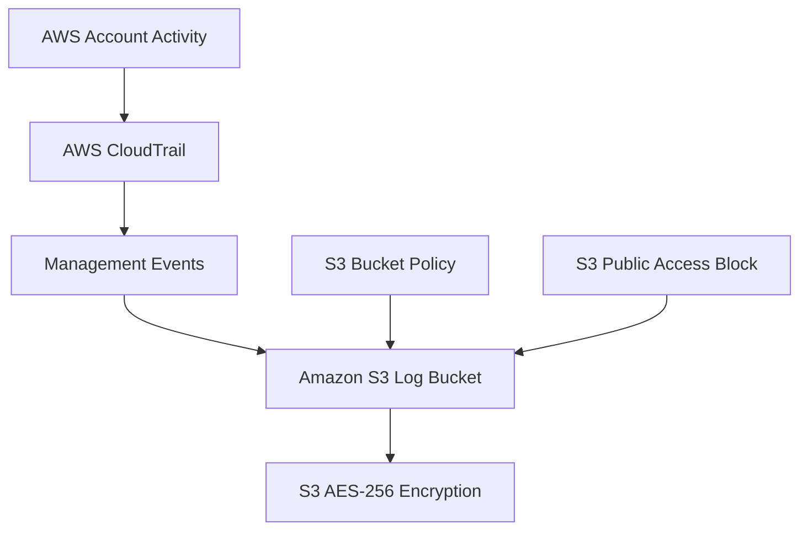

# AWS CloudTrail Terraform Lab

## Project Overview

This project demonstrates how to use Terraform and Ubuntu CLI to plan secure AWS CloudTrail logging infrastructure in AWS `us-east-1`.

**Project status:** Terraform configuration validated and infrastructure plan generated successfully. Resources have not been deployed.

## Architecture



## AWS Services

- AWS CloudTrail
- Amazon S3
- AWS IAM policy documents

## Tools

- Ubuntu Linux CLI
- Terraform
- AWS CLI
- Git and GitHub

## Planned Infrastructure

| Resource | Status |
|---|---|
| CloudTrail multi-region trail | Planned |
| S3 log bucket | Planned |
| S3 bucket policy | Planned |
| S3 public-access block | Planned |
| S3 AES-256 encryption | Planned |

## Validation Evidence

Successfully executed:

```bash
terraform init
terraform fmt
terraform validate
terraform plan -input=false -no-color
```

Verified Terraform output:

```text
Success! The configuration is valid.

Plan: 5 to add, 0 to change, 0 to destroy.
```

## Security

- Public S3 access is blocked in the planned configuration.
- S3 default encryption uses AES-256.
- CloudTrail log-file validation is enabled.
- CloudTrail delivery permissions are restricted through an S3 bucket policy.
- Terraform state and local variable files are excluded from Git.

## Cost Awareness

No infrastructure has been deployed for this project.

Deploying CloudTrail and S3 resources may result in AWS charges for additional event copies, storage, and requests.

## Future Improvements

- Deploy and verify the CloudTrail trail after explicit authorization.
- Add CloudWatch Logs integration.
- Configure log retention and lifecycle policies.
- Test CloudTrail log delivery.

## Portfolio Status

**Validated:** Terraform configuration and plan.

**Not validated:** Actual CloudTrail delivery, S3 object creation, or operational monitoring.
